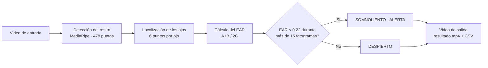

# 😴 Detección de somnolencia en conductores · Visión por computadora → EAR → Alerta

Tutorial **completo y reproducible** para detectar somnolencia a partir de un video: se localiza el rostro con **MediaPipe Face Landmarker** (478 puntos), se mide la apertura de los ojos con el **Eye Aspect Ratio (EAR)** y se activa una **alerta** cuando los ojos permanecen cerrados más de 15 fotogramas consecutivos. Todo se ejecuta en **Google Colab**, sin instalar nada.

[](https://github.com/AndresNenger/deteccion-somnolencia-ear/actions)
[](LICENSE)


## 📓 Notebook

| Notebook | Contenido | Colab |
|---|---|---|
| [`01_deteccion_somnolencia_colab.ipynb`](notebooks/01_deteccion_somnolencia_colab.ipynb) | Pipeline completo en 8 pasos: video → rostro → ojos → EAR → alerta → video de salida, con gráfica del EAR | [](https://colab.research.google.com/github/AndresNenger/deteccion-somnolencia-ear/blob/main/notebooks/01_deteccion_somnolencia_colab.ipynb) |

> Reemplaza `AndresNenger` por tu usuario de GitHub en los enlaces: ver [doc 09](docs/09-subir-a-github.md).

## 🧭 Arquitectura



## 🚀 Inicio rápido

### Google Colab (recomendado)

1. Pulsa **Abrir en Colab** en la tabla de arriba.
2. *Entorno de ejecución → Ejecutar todo*.
3. En el Paso 1 sube tu video (o elige Drive / URL con `FUENTE`).
4. Descarga `resultado.mp4` y `ear.csv`.

### Instalación local

```bash
git clone https://github.com/AndresNenger/deteccion-somnolencia-ear.git
cd deteccion-somnolencia-ear
python -m venv .venv
```

```bash
pip install -r requirements.txt
pip install -e .
pytest -q
```

Procesar un video:

```bash
python scripts/process_video.py mi_video.mp4 -o resultado.mp4 --csv ear.csv
```

Webcam en vivo (solo local):

```bash
python scripts/live_webcam.py
```

## 📚 Tutorial paso a paso

| # | Documento | Qué aprenderás |
|---|---|---|
| 00 | [Introducción](docs/00-introduccion.md) | Objetivo, requisitos y ruta de lectura |
| 01 | [Teoría del EAR](docs/01-teoria-ear.md) | La fórmula, los 6 puntos y por qué hace falta un contador |
| 02 | [Entorno: Colab y local](docs/02-entorno-colab-y-local.md) | Poner todo a correr y resolver errores comunes |
| 03 | [Video de entrada](docs/03-video-de-entrada.md) | Abrir un video y leer fotogramas con OpenCV |
| 04 | [Rostro y landmarks](docs/04-rostro-y-landmarks.md) | MediaPipe Face Landmarker, modo VIDEO, caso sin rostro |
| 05 | [Cálculo del EAR](docs/05-calculo-del-ear.md) | Índices de los ojos, píxeles vs. normalizado, promedio |
| 06 | [Lógica de alerta](docs/06-logica-de-alerta.md) | Umbral + contador; fotogramas vs. segundos |
| 07 | [Video de salida](docs/07-video-de-salida.md) | Dibujar, escribir, reconvertir a H.264 |
| 08 | [Calibración y límites](docs/08-calibracion-y-limites.md) | Qué degrada el resultado y qué NO mide |
| 09 | [Subir a GitHub](docs/09-subir-a-github.md) | Publicar el repositorio, CI y botón de Colab |

## 🗂️ Estructura del repositorio

```
deteccion-somnolencia-ear/
├── README.md
├── LICENSE                      # MIT
├── pyproject.toml
├── requirements.txt
├── .gitignore
├── notebooks/
│   └── 01_deteccion_somnolencia_colab.ipynb
├── src/somnolencia/
│   ├── ear.py                   # fórmula del EAR y landmarks → píxeles
│   ├── detector.py              # umbral + contador (máquina de estados)
│   ├── face.py                  # MediaPipe Face Landmarker
│   └── pipeline.py              # video → EAR → alerta → video de salida
├── scripts/
│   ├── process_video.py         # CLI para procesar un video
│   └── live_webcam.py           # tiempo real con webcam (local)
├── docs/                        # tutorial 00 – 09
├── models/                      # face_landmarker.task (se descarga solo)
├── tests/                       # pytest con datos sintéticos
└── .github/workflows/tests.yml  # CI
```

## ⚙️ Parámetros por defecto

| Parámetro | Valor | Significado |
|---|---|---|
| `UMBRAL_EAR` | 0.22 | Por debajo, el ojo se considera cerrado |
| `FRAMES_CONSECUTIVOS` | 15 | Fotogramas seguidos con ojo cerrado para activar la alerta (0,5 s a 30 fps) |

Son un **punto de partida**: se calibran por persona y cámara ([doc 08](docs/08-calibracion-y-limites.md)).

## ✅ Qué está verificado

- La **fórmula del EAR** y la **lógica de alerta** tienen pruebas automáticas (`pytest`, 17 pruebas con datos sintéticos).
- El pipeline se ejecutó de punta a punta con MediaPipe sobre un video sin rostro (todo `SIN ROSTRO`) y sobre un video hecho con una foto frontal (478 puntos detectados, EAR calculado, video y CSV generados).
- **No se ha evaluado** con un conjunto de datos etiquetado de conducción real, por lo que no hay cifras de sensibilidad/especificidad. Los resultados con tus propios videos dependen de iluminación, ángulo y gafas.

## ⚠️ Seguridad y alcance

Este es un proyecto **educativo**. **No es un dispositivo médico ni un sistema de seguridad vehicular** y no debe usarse para decidir si es seguro conducir. Si sientes somnolencia al volante, detente y descansa. Procesar rostros implica datos biométricos: usa solo videos propios o con consentimiento de quienes aparecen.

## 📖 Referencias y créditos

- T. Soukupová y J. Čech, *Real-Time Eye Blink Detection using Facial Landmarks*, CVWW 2016 (EAR).
- [MediaPipe Face Landmarker](https://ai.google.dev/edge/mediapipe/solutions/vision/face_landmarker) (Google).
- [OpenCV](https://opencv.org/).
- Estructura y formato de tutorial inspirados en [`eeg-mne-bci-motor-control`](https://github.com/AndresNenger/eeg-mne-bci-motor-control) de Andrés Nenger.

## 👤 Autoría y licencia

Distribuido bajo licencia [MIT](LICENSE).
